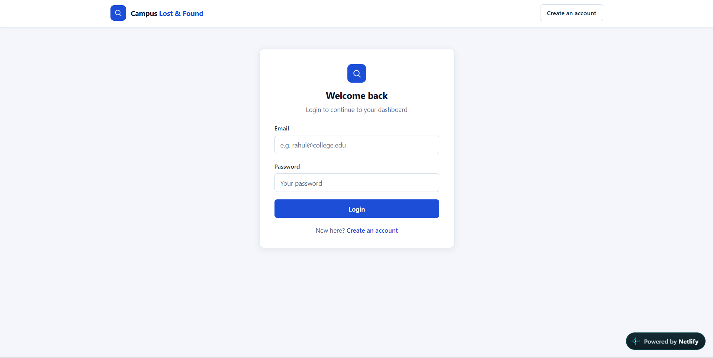
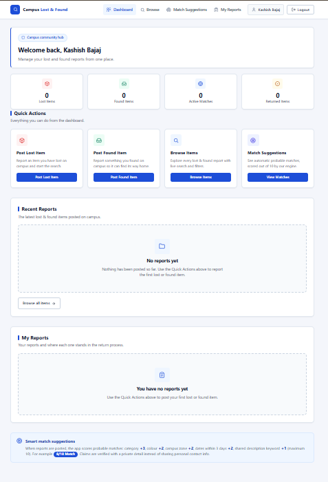
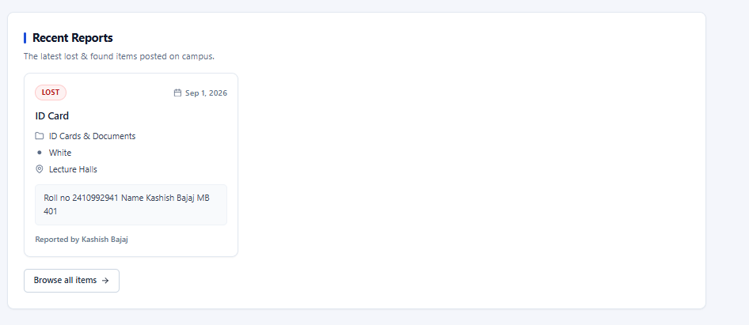
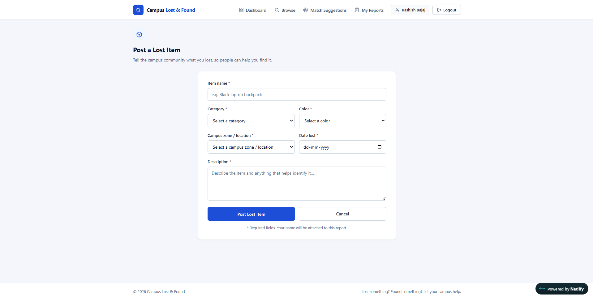

# 🔎 Campus Lost & Found — Full-Stack Web Platform

A full-stack Campus Lost & Found web platform engineered to make reporting, browsing, matching, and recovering lost and found items seamless across a college campus.

Built with a responsive Vanilla HTML/CSS/JavaScript frontend and a robust Node.js/Express MVC backend backed by MongoDB Atlas and deployed on Render and Netlify.

---

## 🌐 Live Deployments & Endpoints

| Component | Service | Public URL | Status |
|---|---|---|---|
| **Frontend Application** | Netlify | [https://campuslost-and-found.netlify.app/](https://campuslost-and-found.netlify.app/) | ✅ Live |
| **Backend REST API** | Render Web Service | [https://campus-lost-and-found-r1d3.onrender.com](https://campus-lost-and-found-r1d3.onrender.com) | ✅ Live |
| **API Health Check** | Render | [https://campus-lost-and-found-r1d3.onrender.com/api/health](https://campus-lost-and-found-r1d3.onrender.com/api/health) | ✅ Active (HTTP 200) |
| **Postman API Collection** | Local / Cloud | `backend/postman/Campus-Lost-And-Found.postman_collection.json` | ✅ 12 Automated Tests |

---

## 📌 Table of Contents

- [Project Overview](#-project-overview)
- [Key Features](#-key-features)
- [Screenshots & Visual Tour](#-screenshots--visual-tour)
- [System Architecture (MVC)](#-system-architecture-mvc)
- [REST API Specifications](#-rest-api-specifications)
- [Technology Stack](#-technology-stack)
- [Monorepo Project Structure](#-monorepo-project-structure)
- [Local Installation & Setup](#-local-installation--setup)
- [Render Deployment Guide](#-render-deployment-guide)
- [Postman API Testing](#-postman-api-testing)
- [Smart Matching Algorithm](#-smart-matching-algorithm)
- [Security & Environment Rules](#-security--environment-rules)

---

## 🚀 Project Overview

In busy college campuses, students frequently misplace valuable belongings — from laptops, chargers, and calculators to ID cards, notebooks, and water bottles. Traditional lost-and-found approaches (verbal inquiries, physical notice boards, or WhatsApp group spam) are fragmented and ineffective.

**Campus Lost & Found** solves this by providing:
1. **Centralized Digital Reporting:** Students report lost or found items with standardized fields (title, category, color, location, date, and descriptions).
2. **Persistent Cloud Database:** Reports are stored in MongoDB Atlas and accessible in real time via REST APIs.
3. **Smart Heuristic Matching:** Compares lost and found items across categories, campus zones, color, date proximity, and keyword overlap, assigning an objective match score (0–10).
4. **Claim & Verification Security:** Finders record private identifying details so claimants must prove ownership before an item is marked as resolved or returned.

---

## ✨ Key Features

- **Interactive User Dashboard:** Quick access to post lost/found items, view recent campus activity, and track personal reports in real time.
- **Dynamic Browse & Filter:** Search and filter reports by type (`lost` or `found`), campus zone (`Library`, `Academic Block`, `Canteen`, etc.), category, color, and date.
- **Real-Time Cloud Synchronization:** The frontend automatically synchronizes with the live Render backend, ensuring reports persist across sessions and devices.
- **Offline / Fallback Resilience:** Gracefully falls back to local storage cache if the cloud service is sleeping or network is unavailable.
- **Role-Based Admin Portal:** Campus administrators can manage user accounts, resolve claims, and audit platform activities.

---

## 📸 Screenshots & Visual Tour

### Login Page
Allows registered students and campus administrators to securely access the platform.


### Sign Up Page
Enables new campus users to create an account with campus email and name.


### Student Dashboard
Central hub showing quick reporting actions, recent campus activity, and personal report tracking.


### Recent Reports
Displays the latest lost and found items submitted across campus.


### Post Lost Item
Structured reporting form to describe lost items with campus zone dropdowns and date validation.


### Post Found Item
Allows finders to report found belongings and record an optional private verification detail for claimant validation.


### Smart Match Suggestions
Analyzes lost and found reports to surface potential matches with transparent score breakdowns.


---

## 🏛️ System Architecture (MVC)

The backend follows clean **Model-View-Controller (MVC)** principles, completely decoupling routing, business logic, data modeling, and error handling:

```text
HTTP Request (Browser / Postman / Netlify)
   │
   ▼
[app.js] ──────── CORS Policy & JSON Body Parsers
   │
   ▼
[routes/index.js] ── Aggregates API endpoints
   ├── /api/health   ──> [controllers/healthController.js]
   └── /api/items    ──> [controllers/itemController.js]
                            │
                            ├── Reads/Writes via [models/Item.js] (Mongoose Schema)
                            │        │
                            │        ▼
                            │   MongoDB Atlas Cloud Database
                            │
                            └── Global Error Boundary [middleware/errorHandler.js]
```

### MVC Directory Responsibilities
- **Models (`backend/models/Item.js`):** Defines the Mongoose schema, field validations, enum restrictions, timestamps, and backward-compatible virtuals (`itemName` ↔ `title`).
- **Controllers (`backend/controllers/`):** Contains business logic for health reporting and CRUD operations (`createItem`, `getItems`, `getItemById`, `updateItem`, `deleteItem`).
- **Routes (`backend/routes/`):** Declares endpoint URL paths and maps them to controller functions.
- **Middleware (`backend/middleware/`):** Centralizes 404 route handling and error sanitization (preventing credential or stack trace leaks).
- **Config (`backend/config/db.js`):** Manages safe connection and disconnection lifecycles with MongoDB Atlas.

---

## 🔌 REST API Specifications

Base URL: `https://campus-lost-and-found-r1d3.onrender.com/api` (Production) or `http://localhost:5000/api` (Local)

### 1. System Endpoints
| Method | Endpoint | Description | Status Code |
|---|---|---|---|
| `GET` | `/` | API welcome banner and endpoint directory | 200 OK |
| `GET` | `/api/health` | Service uptime, timestamp, and environment | 200 OK |

### 2. Item CRUD Endpoints
| Method | Endpoint | Description | Query / Params | Success Status |
|---|---|---|---|---|
| `POST` | `/api/items` | Create a lost or found report | JSON Request Body | `201 Created` |
| `GET` | `/api/items` | List reports (sorted newest first) | `?type=lost` or `?type=found` | `200 OK` |
| `GET` | `/api/items/:id` | Retrieve single item report by ID | `:id` (24-char hex ObjectId) | `200 OK` |
| `PUT` | `/api/items/:id` | Update report fields or status | `:id`, JSON update body | `200 OK` |
| `DELETE`| `/api/items/:id` | Delete report from database | `:id` | `200 OK` |

### Sample Payload: Create Item (`POST /api/items`)
```json
{
  "title": "Black HP Laptop Bag",
  "type": "lost",
  "category": "Bags & Backpacks",
  "description": "Left on 2nd floor library reading desk. Contains notebook and charger.",
  "location": "Library",
  "date": "2026-10-25",
  "color": "Black"
}
```

### Sample Response (`201 Created`):
```json
{
  "success": true,
  "message": "Item report created successfully",
  "data": {
    "_id": "6add1ad8ac2b0385c7b5b7de",
    "title": "Black HP Laptop Bag",
    "type": "lost",
    "category": "Bags & Backpacks",
    "description": "Left on 2nd floor library reading desk. Contains notebook and charger.",
    "location": "Library",
    "date": "2026-10-25T00:00:00.000Z",
    "color": "Black",
    "status": "open",
    "imageUrl": "",
    "createdAt": "2026-10-25T13:00:00.000Z",
    "updatedAt": "2026-10-25T13:00:00.000Z"
  }
}
```

---

## 🛠️ Technology Stack

- **Frontend:** HTML5, CSS3 (Vanilla design system), JavaScript (ES6+), Fetch API
- **Backend Framework:** Node.js, Express.js
- **Database & ODM:** MongoDB Atlas, Mongoose
- **API Testing:** Postman Collection v2.1.0, Node.js Native Test Runner (`node:test`)
- **Cloud Deployment:** Netlify (Frontend CDN), Render (Backend Web Service container)
- **Version Control & CI/CD:** Git, GitHub

---

## 📁 Monorepo Project Structure

```text
Campus-Lost-And-Found/
├── backend/
│   ├── config/
│   │   └── db.js                 # Safe MongoDB Atlas connection handling
│   ├── controllers/
│   │   ├── healthController.js   # Health check controller
│   │   └── itemController.js     # Item CRUD business logic
│   ├── middleware/
│   │   ├── errorHandler.js       # Central JSON error handling & Mongoose formatters
│   │   └── notFoundHandler.js    # Standardized 404 JSON response
│   ├── models/
│   │   └── Item.js               # Mongoose schema and validation rules
│   ├── postman/
│   │   └── Campus-Lost-And-Found.postman_collection.json  # Exported Postman suite
│   ├── routes/
│   │   ├── healthRoutes.js       # Route definition for /api/health
│   │   ├── itemRoutes.js         # Route definition for /api/items
│   │   └── index.js              # Central API router mounting all routes under /api
│   ├── tests/
│   │   ├── health.test.js        # Health & 404 routing tests
│   │   ├── item.test.js          # Offline schema validation tests
│   │   └── items.test.js         # Isolated CRUD controller integration tests
│   ├── .env.example              # Template for environment variables (no secrets)
│   ├── .gitignore                # Backend-specific ignore rules
│   ├── app.js                    # Express app configuration & CORS setup
│   ├── package.json              # Backend dependencies and scripts
│   ├── README.md                 # Backend technical documentation
│   └── server.js                 # Server entry point & graceful container shutdown
├── css/
│   └── style.css                 # Core CSS design system
├── js/
│   ├── admin.js                  # Admin portal controller
│   ├── auth.js                   # Client authentication logic
│   ├── browse.js                 # Live browse and query filters
│   ├── dashboard.js              # Student dashboard controller
│   ├── items.js                  # Shared formatting and card builders
│   ├── matches.js                # Smart matching heuristic algorithm
│   ├── post-item.js              # Item post handler with API integration
│   └── storage.js                # Central API client & local cache fallback
├── screenshots/                  # Application UI screenshots
├── docs/
│   └── BACKEND_MASTER_PLAN.md    # Master architectural roadmap
├── issues/                       # Evaluation tracking issues
├── admin.html                    # Admin management view
├── browse.html                   # Browse lost & found catalog
├── dashboard.html                # User dashboard
├── index.html                    # Welcome & login view
├── matches.html                  # Smart match suggestion view
├── post-item.html                # Report posting form
├── signup.html                   # Registration view
├── .gitignore                    # Root Git ignore rules
└── README.md                     # Main repository documentation
```

---

## 💻 Local Installation & Setup

### 1. Clone the Repository
```bash
git clone https://github.com/SAKSHAMKHATRI/Campus-Lost-And-Found.git
cd Campus-Lost-And-Found
```

### 2. Backend Setup
```bash
cd backend
npm install
cp .env.example .env
```
Open `backend/.env` and insert your MongoDB Atlas URI:
```env
PORT=5000
NODE_ENV=development
CLIENT_ORIGIN=https://campuslost-and-found.netlify.app
MONGODB_URI=mongodb+srv://<username>:<password>@cluster0.mongodb.net/campus-lost-found?retryWrites=true&w=majority
```

Run backend locally:
```bash
# Development mode with nodemon auto-reload:
npm run dev

# Or standard production mode:
npm start
```
Run automated test suite (29 tests):
```bash
npm test
```

### 3. Frontend Setup
Because the frontend is built with vanilla HTML, CSS, and JavaScript, it can be launched using any local web server (e.g. VS Code **Live Server** or Python HTTP server):
```bash
# From repository root:
npx serve .
# Or open index.html directly in your browser
```

---

## ☁️ Render Deployment Guide

The backend is configured for direct deployment as a **Render Web Service** connected to the GitHub repository:

### Render Monorepo Settings
- **Repository:** `SAKSHAMKHATRI/Campus-Lost-And-Found`
- **Branch:** `main`
- **Runtime:** `Node`
- **Root Directory:** `backend` *(Crucial: runs build and start commands inside `backend/`)*
- **Build Command:** `npm install`
- **Start Command:** `npm start`
- **Health Check Path:** `/api/health`

### Render Environment Variables
- `NODE_ENV` = `production`
- `CLIENT_ORIGIN` = `https://campuslost-and-found.netlify.app`
- `MONGODB_URI` = *(Entered securely into the Render Dashboard)*
*(Note: Do not set `PORT` manually; Render provides it dynamically)*

---

## 📮 Postman API Testing

An importable Postman collection containing 12 pre-configured requests with automated test assertion scripts is included at:
`backend/postman/Campus-Lost-And-Found.postman_collection.json`

### Key Features of the Postman Collection:
1. **Dynamic ID Chaining:** Creating an item in `02 - Create Item` automatically parses `data._id` and saves it into the collection variable `{{itemId}}`. Subsequent requests (`GET`, `PUT`, `DELETE`, and `404 verification`) reuse this variable dynamically.
2. **Environment Portability:** Uses a collection variable `{{baseUrl}}`. Switch between:
   - Local: `http://localhost:5000`
   - Render: `https://campus-lost-and-found-r1d3.onrender.com`
3. **Automated Assertion Suite:** Validates HTTP status codes (200, 201, 400, 404), response formats, error messages, and schema compliance.

---

## 🧠 Smart Matching Algorithm

The matching engine in `js/matches.js` scores potential relationships between lost and found items on a scale of **0 to 10**:

1. **Category Match (+3 points):** Lost and found reports share the exact same category.
2. **Campus Location (+2 points):** Both reports occurred in the same campus zone (e.g. Library).
3. **Color Agreement (+2 points):** Items have matching primary colors.
4. **Date Proximity (+2 points):** Report dates are within 3 calendar days of each other.
5. **Keyword Overlap (+1 point):** Shared descriptive keywords across descriptions.

- **8–10 Points:** Strong Match
- **5–7 Points:** Possible Match
- **1–4 Points:** Weak Match

---

## 🔒 Security & Environment Rules

1. **No Credentials in Source Control:** `.env` is ignored by `.gitignore`. Only `.env.example` with blank placeholders is committed.
2. **CORS Whitelisting:** The backend restricts cross-origin browser requests to the deployed Netlify frontend (`https://campuslost-and-found.netlify.app`) and local development origins.
3. **Input Sanitization & Validation:** Mongoose schemas reject invalid types, missing required attributes, and invalid MongoDB ObjectIds.
4. **Log Masking:** Database connection error loggers automatically mask credentials (`***:***`) to prevent accidental credential leakage in logs.
