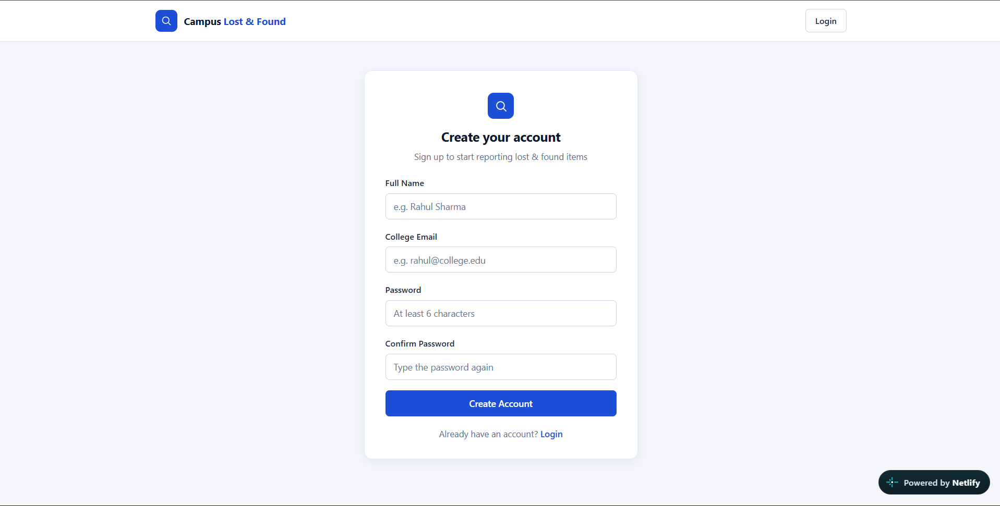
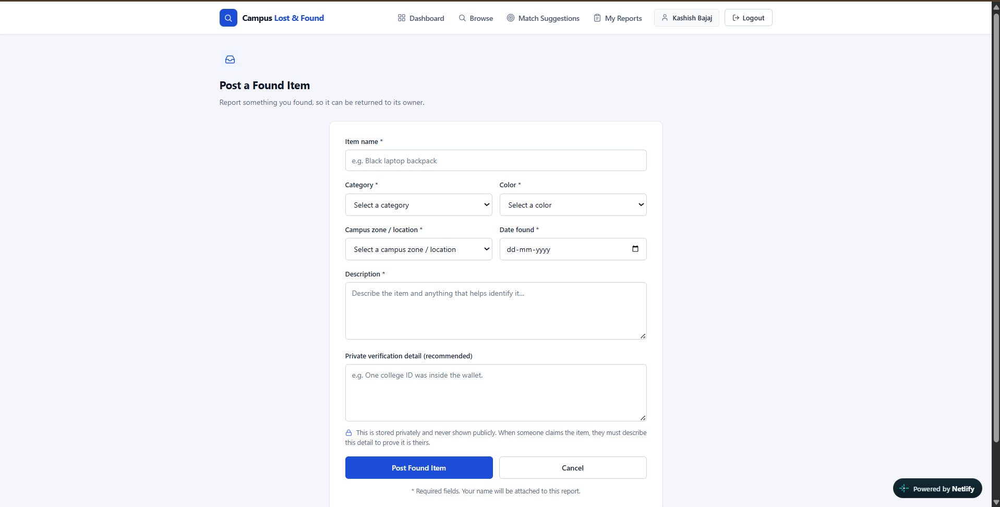
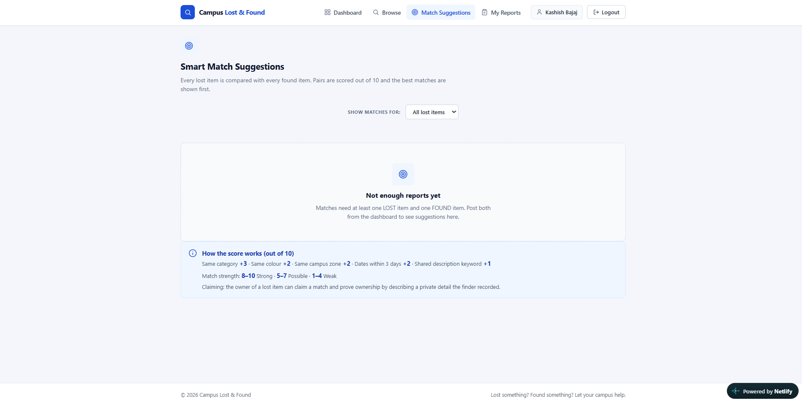
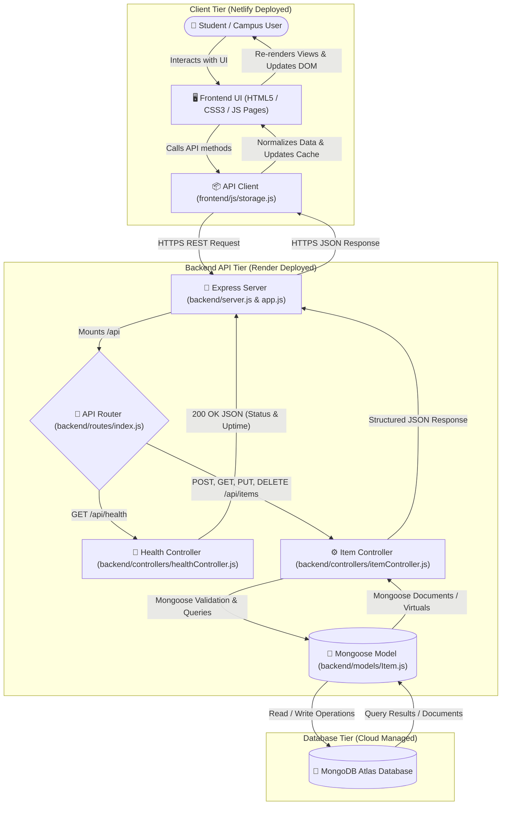
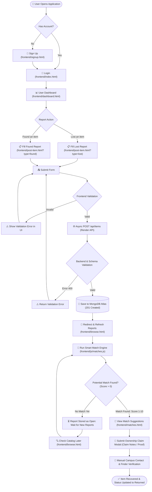
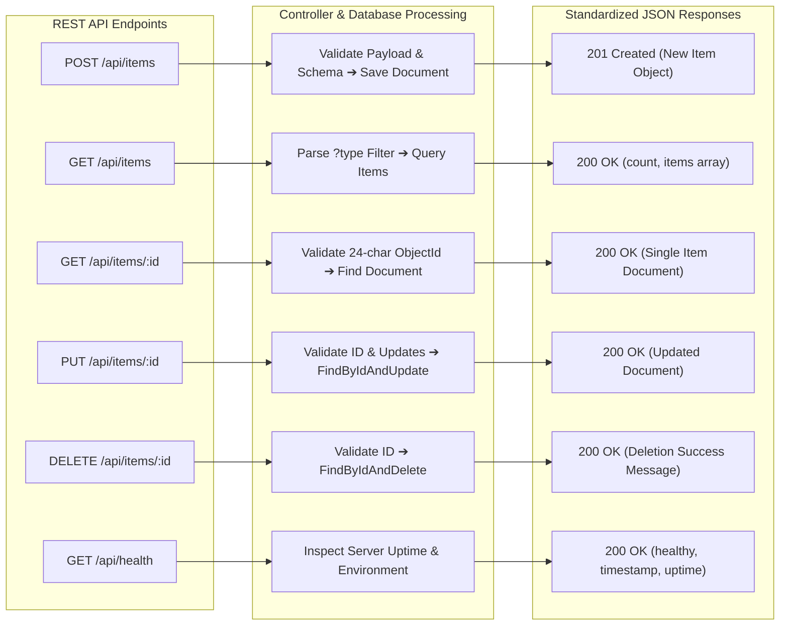

# 🔎 Campus Lost & Found — Full-Stack Web Platform

A full-stack Campus Lost & Found web platform engineered to make reporting, browsing, matching, and recovering lost and found items seamless across a college campus.

Built with a modern monorepo architecture featuring a responsive Vanilla HTML/CSS/JavaScript client in [`frontend/`](./frontend/README.md) and a robust Node.js/Express MVC REST API in [`backend/`](./backend/README.md) backed by MongoDB Atlas, deployed across Render and Netlify.

---

## 🌐 Live Deployments & Endpoints

| Component | Service | Public URL | Status |
|---|---|---|---|
| **Frontend Application** | Netlify | [https://campuslost-and-found.netlify.app/](https://campuslost-and-found.netlify.app/) | ✅ Live |
| **Backend REST API** | Render Web Service | [https://campus-lost-and-found-r1d3.onrender.com](https://campus-lost-and-found-r1d3.onrender.com) | ✅ Live |
| **API Health Check** | Render | [https://campus-lost-and-found-r1d3.onrender.com/api/health](https://campus-lost-and-found-r1d3.onrender.com/api/health) | ✅ Active (HTTP 200) |
| **Postman API Collection** | Local / Cloud | `backend/postman/Campus-Lost-And-Found.postman_collection.json` | ✅ 12 Automated Tests |

---

## 📌 Table of Contents

- [Project Overview](#-project-overview)
- [Key Features](#-key-features)
- [Screenshots & Visual Tour](#-screenshots--visual-tour)
- [Subsystem Documentation](#-subsystem-documentation)
- [System Architecture (MVC)](#-system-architecture-mvc)
- [Full-Stack System Flowchart](#-full-stack-system-flowchart)
  - [Architecture & End-to-End Data Flow](#-architecture--end-to-end-data-flow)
  - [User Journey: Reporting and Recovering an Item](#-user-journey-reporting-and-recovering-an-item)
  - [CRUD API Request Lifecycles](#-crud-api-request-lifecycles)
- [REST API Specifications](#-rest-api-specifications)
- [Technology Stack](#-technology-stack)
- [Monorepo Project Structure](#-monorepo-project-structure)
- [Local Installation & Setup](#-local-installation--setup)
- [Deployment Guides](#-deployment-guides)
  - [Netlify Frontend Deployment](#1-netlify-frontend-deployment)
  - [Render Backend Deployment](#2-render-backend-deployment)
- [Postman API Testing](#-postman-api-testing)
- [Smart Matching Algorithm](#-smart-matching-algorithm)
- [Security & Environment Rules](#-security--environment-rules)

---

## 🚀 Project Overview

In busy college campuses, students frequently misplace valuable belongings — from laptops, chargers, and calculators to ID cards, notebooks, and water bottles. Traditional lost-and-found approaches (verbal inquiries, physical notice boards, or WhatsApp group spam) are fragmented and ineffective.

**Campus Lost & Found** solves this by providing:
1. **Centralized Digital Reporting:** Students report lost or found items with standardized fields (title, category, color, location, date, and descriptions).
2. **Persistent Cloud Database:** Reports are stored in MongoDB Atlas and accessible in real time via REST APIs.
3. **Smart Heuristic Matching:** Compares lost and found items across categories, campus zones, color, date proximity, and keyword overlap, assigning an objective match score (0–10).
4. **Claim & Verification Security:** Finders record private identifying details so claimants must prove ownership before an item is marked as resolved or returned.

---

## ✨ Key Features

- **Interactive User Dashboard:** Quick access to post lost/found items, view recent campus activity, and track personal reports in real time.
- **Dynamic Browse & Filter:** Search and filter reports by type (`lost` or `found`), campus zone (`Library`, `Academic Block`, `Canteen`, etc.), category, color, and date.
- **Real-Time Cloud Synchronization:** The frontend automatically synchronizes with the live Render backend, ensuring reports persist across sessions and devices.
- **Offline / Fallback Resilience:** Gracefully falls back to local storage cache if the cloud service is sleeping or network is unavailable.
- **Role-Based Admin Portal:** Campus administrators can manage user accounts, resolve claims, and audit platform activities.

---

## 📸 Screenshots & Visual Tour

### Login Page
Allows registered students and campus administrators to securely access the platform.


### Sign Up Page
Enables new campus users to create an account with campus email and name.


### Student Dashboard
Central hub showing quick reporting actions, recent campus activity, and personal report tracking.


### Recent Reports
Displays the latest lost and found items submitted across campus.


### Post Lost Item
Structured reporting form to describe lost items with campus zone dropdowns and date validation.


### Post Found Item
Allows finders to report found belongings and record an optional private verification detail for claimant validation.


### Smart Match Suggestions
Analyzes lost and found reports to surface potential matches with transparent score breakdowns.


---

## 📚 Subsystem Documentation

Detailed guides and implementation notes for each subsystem are maintained in their respective directories:

- 🖥️ **Frontend Documentation:** [`frontend/README.md`](./frontend/README.md) — Client architecture, UI features, LocalStorage caching, API integration, and Netlify configuration.
- ⚙️ **Backend Documentation:** [`backend/README.md`](./backend/README.md) — Express MVC server, Mongoose data models, error handling, test suite, and Render container configuration.

---

## 🏛️ System Architecture (MVC)

The backend follows clean **Model-View-Controller (MVC)** principles, completely decoupling routing, business logic, data modeling, and error handling:

```text
HTTP Request (Browser / Postman / Netlify)
   │
   ▼
[app.js] ──────── CORS Policy & JSON Body Parsers
   │
   ├──▶ [/api/health] ──▶ healthController.js
   │                         └── Returns server health, timestamp, and uptime
   │
   └──▶ [/api/items]  ──▶ itemRoutes.js ──▶ itemController.js
                                                │
                                                ├── Validate ID & payload
                                                ├── Query MongoDB Atlas
                                                └── Item.js (Mongoose Model)
                                                        └── Schema validation
                                                        └── Timestamps & normalization
```

---

## 🔄 Full-Stack System Flowchart

The following interactive flowcharts illustrate the system architecture, student lifecycle, and REST API operations across the monorepo.

### 🌐 Architecture & End-to-End Data Flow

This flowchart illustrates the end-to-end request and response cycle between the student, the Netlify static frontend, the Render Express API, and MongoDB Atlas. The `/api/health` monitoring endpoint is shown as an independent branch.



### 👤 User Journey: Reporting and Recovering an Item

This diagram maps the complete student journey from authentication and report creation through heuristic matching and item recovery.



> [!NOTE]
> **Claim & Ownership Verification:** In accordance with the current platform implementation, claim submissions record the claimant's explanation notes for finder and administrator review. Notifications and direct item handover are coordinated directly between campus users.

### ⚡ CRUD API Request Lifecycles

This diagram illustrates the lifecycle of each REST endpoint, from initial client call and controller validation through MongoDB Atlas database operations and standardized JSON responses.



---

## 📡 REST API Specifications

The backend exposes standardized JSON REST endpoints mounted under `/api`:

| Method | Endpoint | Description | Request Body | Success Response |
|---|---|---|---|---|
| `GET` | `/` | API Root Welcome | None | `200 OK` (Service metadata) |
| `GET` | `/api/health` | Health Check & Uptime | None | `200 OK` (`status: "healthy"`) |
| `POST` | `/api/items` | Create Lost/Found Report | `title`, `type`, `category`, `description`, `location`, `date`, `color` | `201 Created` (`data: Item`) |
| `GET` | `/api/items` | List All Reports | None | `200 OK` (`count`, `data: Item[]`) |
| `GET` | `/api/items?type=lost` | Filter Lost Reports | None | `200 OK` (Only lost items) |
| `GET` | `/api/items?type=found`| Filter Found Reports | None | `200 OK` (Only found items) |
| `GET` | `/api/items/:id` | Get Report by ID | None | `200 OK` (`data: Item`) |
| `PUT` | `/api/items/:id` | Update Report by ID | Partial or full item fields | `200 OK` (`data: updatedItem`) |
| `DELETE` | `/api/items/:id` | Delete Report by ID | None | `200 OK` (`message: "Item deleted"`) |

---

## 🛠️ Technology Stack

- **Frontend:** HTML5, CSS3 (Custom Responsive Design System), JavaScript (ES6+ Modules, Fetch API, LocalStorage Cache)
- **Backend:** Node.js, Express.js (MVC Architecture, CORS, Router Middleware)
- **Database:** MongoDB Atlas (Cloud Managed NoSQL) via Mongoose ODM
- **Automated Testing:** Node.js Built-in Test Runner (`node:test`, `node:assert`)
- **API Tooling:** Postman Collection v2.1.0 with dynamic ID chaining and automated tests
- **Cloud Deployment:** Netlify (Frontend CDN), Render (Backend Web Service container)

---

## 📁 Monorepo Project Structure

```text
Campus-Lost-And-Found/
├── frontend/                     # Client application (HTML, CSS, JS)
│   ├── css/
│   │   └── style.css             # Unified responsive design system
│   ├── js/
│   │   ├── admin.js              # Admin portal controller
│   │   ├── auth.js               # Client authentication & session management
│   │   ├── browse.js             # Live browse, search & query filters
│   │   ├── dashboard.js          # Student dashboard & quick stats
│   │   ├── items.js              # Shared formatting and card builders
│   │   ├── matches.js            # Smart matching heuristic algorithm
│   │   ├── post-item.js          # Item post handler with API integration
│   │   └── storage.js            # Central API client & local cache fallback
│   ├── screenshots/              # Application UI screenshots
│   ├── admin.html                # Admin management view
│   ├── browse.html               # Browse lost & found catalog
│   ├── dashboard.html            # User dashboard
│   ├── index.html                # Welcome & login view
│   ├── matches.html              # Smart match suggestion view
│   ├── post-item.html            # Report posting form
│   ├── signup.html               # Registration view
│   └── README.md                 # Frontend technical documentation
├── backend/                      # Node.js/Express MVC REST API
│   ├── config/
│   │   └── db.js                 # Safe MongoDB Atlas connection & error masking
│   ├── controllers/
│   │   ├── healthController.js   # Health check controller
│   │   └── itemController.js     # Full CRUD controller (create, list, get, update, delete)
│   ├── middleware/
│   │   ├── errorHandler.js       # Central JSON error handling & Mongoose formatters
│   │   └── notFoundHandler.js    # Standardized 404 JSON response
│   ├── models/
│   │   └── Item.js               # Mongoose schema, validation rules & field virtuals
│   ├── postman/
│   │   └── Campus-Lost-And-Found.postman_collection.json  # Exported Postman suite
│   ├── routes/
│   │   ├── healthRoutes.js       # Route definition for /api/health
│   │   ├── itemRoutes.js         # Route definition for /api/items
│   │   └── index.js              # Central API router mounting all routes under /api
│   ├── tests/
│   │   ├── health.test.js        # Health & 404 routing tests
│   │   ├── item.test.js          # Offline schema validation tests
│   │   └── items.test.js         # Isolated CRUD controller integration tests
│   ├── .env.example              # Template for environment variables (no secrets)
│   ├── .gitignore                # Backend-specific ignore rules
│   ├── app.js                    # Express app configuration & CORS setup
│   ├── package.json              # Backend dependencies and scripts
│   ├── README.md                 # Backend technical documentation
│   └── server.js                 # Server entry point & graceful container shutdown
├── docs/
│   └── BACKEND_MASTER_PLAN.md    # Master architectural roadmap
├── issues/                       # Evaluation tracking issues
├── netlify.toml                  # Netlify monorepo deployment configuration
├── .gitignore                    # Root Git ignore rules
└── README.md                     # Main repository documentation (this file)
```

---

## 💻 Local Installation & Setup

### 1. Clone the Repository
```bash
git clone https://github.com/SAKSHAMKHATRI/Campus-Lost-And-Found.git
cd Campus-Lost-And-Found
```

### 2. Backend Setup
```bash
cd backend
npm install
cp .env.example .env
```
Open `backend/.env` and insert your MongoDB Atlas URI:
```env
PORT=5000
NODE_ENV=development
CLIENT_ORIGIN=https://campuslost-and-found.netlify.app
MONGODB_URI=mongodb+srv://<username>:<password>@cluster0.mongodb.net/campus-lost-found?retryWrites=true&w=majority
```

Run backend locally:
```bash
# Development mode with nodemon auto-reload:
npm run dev

# Or standard production mode:
npm start
```
Run automated test suite (29 tests):
```bash
npm test
```

### 3. Frontend Setup
Because the frontend is built with vanilla HTML, CSS, and JavaScript, it can be launched using any static local server:
```bash
# From repository root:
npx serve frontend

# Or using Python from inside frontend/:
cd frontend && python3 -m http.server 8080
```
Or open [`frontend/index.html`](./frontend/index.html) directly using VS Code **Live Server**.

---

## ☁️ Deployment Guides

### 1. Netlify Frontend Deployment

The static frontend in `frontend/` is deployed to Netlify:

#### Monorepo Build Configuration
The repository includes [`netlify.toml`](./netlify.toml) in the root:
```toml
[build]
  publish = "frontend"
```

#### Netlify Dashboard Settings:
If setting up or verifying the Netlify site in the Netlify Dashboard:
- **Site Name:** `campuslost-and-found`
- **Base directory:** *(leave empty)*
- **Publish directory:** `frontend`
- **Build command:** *(leave empty)*

---

### 2. Render Backend Deployment

The backend is configured for direct deployment as a **Render Web Service** connected to the GitHub repository:

#### Render Monorepo Settings
- **Repository:** `SAKSHAMKHATRI/Campus-Lost-And-Found`
- **Branch:** `main`
- **Runtime:** `Node`
- **Root Directory:** `backend` *(Crucial: runs build and start commands inside `backend/`)*
- **Build Command:** `npm install`
- **Start Command:** `npm start`
- **Health Check Path:** `/api/health`

#### Render Environment Variables
- `NODE_ENV` = `production`
- `CLIENT_ORIGIN` = `https://campuslost-and-found.netlify.app`
- `MONGODB_URI` = *(Entered securely into the Render Dashboard)*
*(Note: Do not set `PORT` manually; Render provides it dynamically)*

---

## 📮 Postman API Testing

An importable Postman collection containing 12 pre-configured requests with automated test assertion scripts is included at:
`backend/postman/Campus-Lost-And-Found.postman_collection.json`

### Key Features of the Postman Collection:
1. **Dynamic ID Chaining:** Creating an item in `02 - Create Item` automatically parses `data._id` and saves it into the collection variable `{{itemId}}`. Subsequent requests (`GET`, `PUT`, `DELETE`, and `404 verification`) reuse this variable dynamically.
2. **Environment Portability:** Uses a collection variable `{{baseUrl}}`. Switch between:
   - Local: `http://localhost:5000`
   - Render: `https://campus-lost-and-found-r1d3.onrender.com`
3. **Automated Assertion Suite:** Validates HTTP status codes (200, 201, 400, 404), response formats, error messages, and schema compliance.

---

## 🧠 Smart Matching Algorithm

The matching engine in [`frontend/js/matches.js`](./frontend/js/matches.js) scores potential relationships between lost and found items on a scale of **0 to 10**:

1. **Category Match (+3 points):** Lost and found reports share the exact same category.
2. **Campus Location (+2 points):** Both reports occurred in the same campus zone (e.g. Library).
3. **Color Agreement (+2 points):** Items have matching primary colors.
4. **Date Proximity (+2 points):** Report dates are within 3 calendar days of each other.
5. **Keyword Overlap (+1 point):** Shared descriptive keywords across descriptions.

- **8–10 Points:** Strong Match
- **5–7 Points:** Possible Match
- **1–4 Points:** Weak Match

---

## 🔒 Security & Environment Rules

1. **No Credentials in Source Control:** `.env` is ignored by `.gitignore`. Only `.env.example` with blank placeholders is committed.
2. **CORS Whitelisting:** The backend restricts cross-origin browser requests to the deployed Netlify frontend (`https://campuslost-and-found.netlify.app`) and local development origins.
3. **Input Sanitization & Validation:** Mongoose schemas reject invalid types, missing required attributes, and invalid MongoDB ObjectIds.
4. **Log Masking:** Database connection error loggers automatically mask credentials (`***:***`) to prevent accidental credential leakage in logs.
